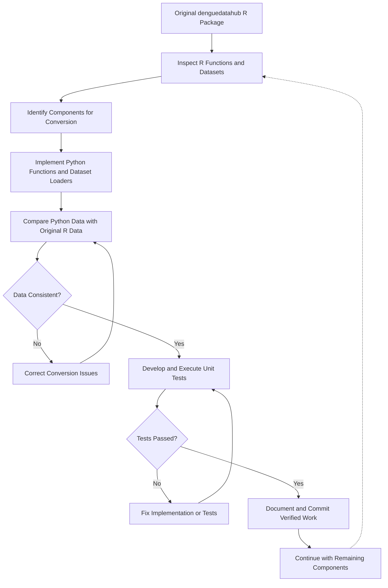

# DengueDataHub – Python Implementation

**A Python implementation of the [denguedatahub R package](https://github.com/thiyangt/denguedatahub).**

**Project Status:** Under Active Development

## Introduction

DengueDataHub is an R package developed to provide the research community with a unified collection of worldwide dengue-related datasets, together with exogenous variables that support the understanding of dengue transmission and the reproducibility of research.

The **denguedatahubpythonicway** project aims to develop a Python implementation of the original R package, making its datasets and relevant functionality accessible within the Python ecosystem.

The project focuses on translating R functions into Python, integrating dengue-related datasets from multiple geographical regions, and developing reusable functions for data loading, preprocessing, and transformation.

An important aspect of this implementation is maintaining consistency between the original R datasets and their Python equivalents through systematic data comparison, validation, and unit testing.

This project is undertaken as part of **DSA 609 – Seminar Course**, MSc in Data Science and Artificial Intelligence, University of Sri Jayewardenepura, Sri Lanka.

## Objectives

The main objective is to develop a functional, reliable, and reusable Python implementation of the existing denguedatahub R package.

The specific objectives are:

1. **Analyze the existing R package:** Examine R functions, datasets, dependencies, and package structure to identify components for Python implementation.

2. **Convert R functions into Python:** Implement equivalent Python functionality while preserving the intended behavior of the original R functions.

3. **Integrate dengue-related datasets:** Convert and organize existing dengue datasets into Python-compatible formats.

4. **Preserve data integrity:** Validate Python datasets against their original R equivalents, ensuring consistency in data values, structure, and missing-value representation.

5. **Implement data preprocessing:** Develop reusable functions for normalization, cleaning, loading, and transformation.

6. **Ensure reliability through testing:** Develop and execute unit tests using Pytest to verify implemented functionality.

7. **Develop a reusable Python package:** Organize modules, datasets, and tests into a maintainable Python package.

## Project Workflow

The project follows an incremental development workflow consisting of six main stages.

### Stage 1: Examination of the Original R Package

- Examine the structure of the original denguedatahub repository.
- Inspect R functions and their intended purposes.
- Identify datasets available in the original `data/` and `data-raw/` directories.
- Review relevant R documentation.
- Identify components requiring Python implementation.

### Stage 2: Python Package Development

- Establish the Python package structure.
- Configure dependencies and project metadata.
- Translate selected R functions into Python.
- Implement reusable data-loading and preprocessing modules.

### Stage 3: Dataset Integration

- Identify existing tidy datasets from the original R package.
- Examine original R dataset structures and data types.
- Convert datasets into Python-compatible formats where necessary.
- Implement corresponding Python dataset-loading functions.

### Stage 4: Data Validation

- Compare Python datasets against their original R equivalents.
- Verify dataset dimensions and column names.
- Compare data values and data types.
- Check missing values and character encoding.
- Identify and correct inconsistencies introduced during conversion.

### Stage 5: Unit Testing

- Develop corresponding unit tests for Python modules.
- Execute tests using Pytest.
- Verify expected outputs and data-loading functionality.
- Correct identified issues.
- Repeat testing after modifications.

### Stage 6: Documentation and Further Development

- Document implemented modules and datasets.
- Update the README and project structure.
- Maintain version control through Git and GitHub.
- Continue converting remaining components of the original R package.

## Workflow Diagram



## Current Implementation Progress

The project has progressed from implementing basic data-processing functions to developing and validating Python modules for dengue-related datasets from multiple sources.

### 1. Data Processing and Transformation

| Module | Description |
|---|---|
| `min_max.py` | Performs min-max normalization, including grouped normalization. |
| `get_pdflinks_srilanka.py` | Retrieves links to Sri Lankan Weekly Epidemiological Reports. |
| `download_pdfwer_srilanka.py` | Downloads Weekly Epidemiological Report PDF files. |
| `convert_slwer_to_tidy.py` | Extracts and restructures epidemiological report tables into tidy data. |

### 2. Sri Lankan Dengue Data

| Module | Description |
|---|---|
| `load_sl_annual.py` | Loads annual dengue-related data for Sri Lanka. |
| `load_sl_province_districts.py` | Loads Sri Lankan province and district information. |
| `load_sl_sites.py` | Loads information on Sri Lankan dengue-related sites. |
| `load_srilanka_2020.py` | Loads the Sri Lankan dengue dataset for 2020. |
| `load_srilanka_weekly_data.py` | Loads weekly dengue-related data for Sri Lanka. |

### 3. International Dengue Data

| Module | Description |
|---|---|
| `load_americas_annual_data.py` | Loads annual dengue-related data for the Americas. |
| `load_china_annual_data.py` | Loads annual dengue-related data for China. |
| `load_india_annual_data.py` | Loads annual dengue-related data for India. |
| `load_level_of_risk.py` | Loads the dengue-related level-of-risk dataset. |

### 4. CDC Dengue Data

| Module | Description |
|---|---|
| `cdc.py` | Provides CDC-related functionality. |
| `load_cdc_casesby_week.py` | Loads dengue case data organized by week. |
| `load_cdc_dengue_agesex.py` | Loads dengue-related data categorized by age and sex. |
| `load_cdc_dengue_casesbyjurisdiction.py` | Loads dengue cases categorized by jurisdiction. |
| `load_cdc_dengue_countyear.py` | Loads yearly dengue count data. |
| `load_cdc_local_dengue_cases.py` | Loads locally acquired dengue case data. |
| `load_cdc_travel_associated_dengue_cases.py` | Loads travel-associated dengue case data. |
| `load_cdc_usa_dengue_infection.py` | Loads dengue infection data for the United States. |

**Note:** PDF-related modules were developed during the initial conversion stages. Subsequent development prioritizes reusing existing tidy datasets from the original R package where available, reducing unnecessary PDF extraction.

## Dataset Conversion and Validation

Dataset conversion is an important component of this project. Existing datasets from the original R package are examined, converted where necessary, and integrated into the Python implementation.

Converted datasets are compared with their original R equivalents to verify consistency in structure, values, missing data, and character encoding.

### Dataset Implementation Progress

As of 29 October 2026:

| Description | Progress |
|---|---|
| Identified dataset items | 21 |
| Completed dataset implementations | 16 |
| Remaining dataset implementations | 5 |
| Dataset completion | 76.2% |

This percentage represents progress against the identified dataset items and does not indicate completion of the entire R-to-Python package conversion.

### Selected Validation Results

**Sri Lanka 2020 Dataset**
- Verified 1,326 records.
- Confirmed epidemiological weeks 1–51.
- Verified that dengue case values contain no missing entries.

**China Annual Dataset**
- Validated against the original R dataset.
- Confirmed 16 rows and 5 columns.
- Corrected numeric parsing involving thousands separators.
- Verified consistency between the R and Python datasets.

**India Annual Dataset**
- Implemented the Python data loader.
- Verified 432 rows and 5 columns.
- Compared the dataset with the original R data, including expected missing values.

**Level of Risk Dataset**
- Implemented the Python data loader.
- Verified 293 rows and 4 columns.
- Confirmed consistency with the original R dataset.
- Corrected character encoding for `São Tomé and Príncipe`.
- Confirmed that the dataset contains no missing values.

### Remaining Dataset Work

The following dataset items remain to be completed:

1. `philippines_daily_data`
2. `singapore_weekly_data`
3. `sl_dengue_serotype`
4. `taiwan_dengue`
5. `world_annual`

## Repository Structure

The repository separates Python modules, datasets, and unit tests into dedicated directories.

```text
denguedatahubpythonicway/
│
├── denguedatahub/
│   ├── __init__.py
│   ├── data/
│   ├── data-raw/
│   ├── cdc.py
│   ├── min_max.py
│   ├── get_pdflinks_srilanka.py
│   ├── download_pdfwer_srilanka.py
│   ├── convert_slwer_to_tidy.py
│   ├── load_sl_annual.py
│   ├── load_sl_province_districts.py
│   ├── load_sl_sites.py
│   ├── load_srilanka_2020.py
│   ├── load_srilanka_weekly_data.py
│   ├── load_americas_annual_data.py
│   ├── load_china_annual_data.py
│   ├── load_india_annual_data.py
│   ├── load_level_of_risk.py
│   ├── load_cdc_casesby_week.py
│   ├── load_cdc_dengue_agesex.py
│   ├── load_cdc_dengue_casesbyjurisdiction.py
│   ├── load_cdc_dengue_countyear.py
│   ├── load_cdc_local_dengue_cases.py
│   ├── load_cdc_travel_associated_dengue_cases.py
│   └── load_cdc_usa_dengue_infection.py
│
├── tests/
│   └── Unit test files for implemented modules
│
├── .gitignore
├── pyproject.toml
└── README.md
```

The structure above summarizes the main implementation files rather than listing every dataset and test file.

## Installation

The Python implementation can be installed locally from the GitHub repository.

### 1. Clone the Repository

```bash
git clone https://github.com/thiyangt/denguedatahubpythonicway.git
```

### 2. Navigate to the Project Directory

```bash
cd denguedatahubpythonicway
```

### 3. Install the Package

Install the package in editable mode:

```bash
python -m pip install -e .
```

This allows changes made to the local Python modules to be reflected without reinstalling the package.

## Testing and Validation

Unit testing is performed using **Pytest**.

Tests have been developed for the implemented data-loading, preprocessing, and transformation functions.

### Latest Test Results

As of 29 October 2026:

**29 tests passed successfully.**

Additional dataset validation has been performed by comparing selected Python datasets with their original R equivalents.

### Running the Tests

Install Pytest if necessary:

```bash
python -m pip install pytest
```

From the repository root directory, execute:

```bash
python -m pytest -v
```

This command executes the test suite and displays the results of individual tests.

Testing is repeated whenever new modules are implemented or existing functionality is modified.

## Future Work

Although the currently implemented components have passed their tests, the overall project remains under development.

Planned activities include:

- Complete the five remaining identified dataset implementations.
- Continue examining remaining R functions and documentation.
- Extend the Python implementation to additional components of the original package.
- Continue validating Python datasets against original R datasets.
- Expand unit test coverage.
- Improve package documentation.
- Refine package organization and usability.

## Original Project and References

This Python implementation is based on the original **denguedatahub R package**.

- **Original R Package:** https://github.com/thiyangt/denguedatahub
- **Original Package Website:** https://thiyangt.github.io/denguedatahubweb/
- **Python Implementation:** https://github.com/thiyangt/denguedatahubpythonicway

## Project Status

**Status: Under Active Development**

As of 29 October 2026, 16 of the 21 identified dataset items have been implemented, and the Python test suite has achieved 29 passing tests.

Development continues toward completing the remaining datasets, extending Python functionality, and maintaining consistency with the original R package.
