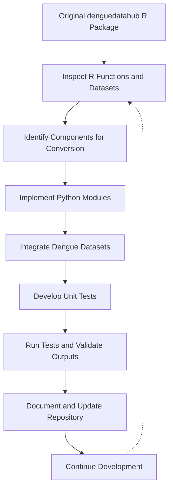

# DengueDataHub – Python Implementation

## Introduction

Dengue is a significant public health concern in many tropical and subtropical countries. Access to organized and reliable dengue-related datasets is essential for epidemiological research, disease surveillance, statistical analysis, and data-driven decision-making.

The **denguedatahubpythonicway** project aims to develop a Python implementation of the existing [denguedatahub R package](https://github.com/thiyangt/denguedatahub).

The project focuses on translating relevant R functions into Python, integrating existing dengue-related datasets, and developing reusable Python functions for data loading, preprocessing, and transformation.

The implementation follows an incremental development approach, with unit testing used to verify the functionality of the converted components. The package currently includes data-loading modules for Sri Lanka, China, the Americas, and CDC-related dengue datasets.

This project is undertaken as part of **DSA 609 – Seminar Course**, MSc in Data Science and Artificial Intelligence, University of Sri Jayewardenepura, Sri Lanka.

## Objectives

The main objective of this project is to develop a functional, tested, and reusable Python implementation of the existing denguedatahub R package.

The specific objectives are:

1. **Analyze the existing R package:** Examine the original R functions, datasets, dependencies, and package structure to identify the components required for Python implementation.

2. **Convert R functions into Python:** Implement equivalent Python functions while preserving the intended functionality of the original R implementations.

3. **Integrate dengue-related datasets:** Identify, organize, and load existing dengue datasets into Python-compatible data structures for further analysis.

4. **Implement data preprocessing and transformation:** Develop functions for data normalization, cleaning, and restructuring using appropriate Python libraries.

5. **Ensure functionality through testing:** Develop and execute unit tests using Pytest to verify the correctness and reliability of the implemented Python modules.

6. **Develop a reusable Python package:** Organize the implementation into a modular Python package that can be maintained, extended, and used for dengue-related data analysis.

## Project Workflow

The project follows an incremental development workflow consisting of five main stages.

### Stage 1: Examination of the Original R Package

- Examine the structure of the original denguedatahub repository.
- Inspect R functions and identify their intended purposes.
- Identify datasets and data-processing scripts.
- Classify components according to their relevance to the Python implementation.
- Determine the appropriate Python equivalents for selected R functions.

### Stage 2: Python Package Development

- Establish the Python package structure.
- Configure package dependencies and project metadata.
- Translate selected R functions into Python modules.
- Implement data-loading and preprocessing functions.
- Organize related functionality into reusable modules.

### Stage 3: Dataset Integration

- Examine the datasets available in the original R package.
- Identify existing tidy datasets that can be reused directly.
- Organize datasets under the appropriate package directories.
- Implement Python functions to load datasets into Python-compatible data structures.
- Extend support for Sri Lankan and international dengue datasets.

### Stage 4: Testing and Validation

- Develop corresponding unit tests for implemented Python modules.
- Execute tests using Pytest.
- Verify expected outputs and handle identified errors.
- Validate data-loading and preprocessing functionality.
- Repeat testing as new modules are added or existing modules are modified.

### Stage 5: Documentation and Further Development

- Document the purpose and functionality of implemented modules.
- Maintain the repository using Git and GitHub.
- Update the README as new components are developed.
- Extend dataset support and implement additional functions.
- Improve package usability and documentation.

## Workflow Diagram



## Current Implementation Progress

The project has progressed from implementing basic data-processing functions to developing and testing Python modules for loading dengue-related datasets from multiple sources.

The current implementation contains **19 Python modules**, excluding the package initialization file.

### 1. Data Processing and Transformation

| Module | Description |
|---|---|
| `min_max.py` | Implements min-max normalization, including support for grouped data. |
| `get_pdflinks_srilanka.py` | Retrieves links to Sri Lankan Weekly Epidemiological Reports. |
| `download_pdfwer_srilanka.py` | Downloads Weekly Epidemiological Report PDF files. |
| `convert_slwer_to_tidy.py` | Extracts and restructures epidemiological report tables into tidy data. |

### 2. Sri Lankan Dengue Data

| Module | Description |
|---|---|
| `load_sl_annual.py` | Loads annual dengue-related data for Sri Lanka. |
| `load_sl_province_districts.py` | Loads Sri Lankan province and district information. |
| `load_sl_sites.py` | Loads information on Sri Lankan dengue-related sites. |
| `load_srilanka_2020.py` | Loads the Sri Lankan dengue dataset for 2020. |
| `load_srilanka_weekly_data.py` | Loads weekly dengue-related data for Sri Lanka. |

### 3. International Dengue Data

| Module | Description |
|---|---|
| `load_americas_annual_data.py` | Loads annual dengue-related data for the Americas. |
| `load_china_annual_data.py` | Loads annual dengue-related data for China. |

### 4. CDC Dengue Data

| Module | Description |
|---|---|
| `cdc.py` | Provides CDC-related functionality. |
| `load_cdc_casesby_week.py` | Loads dengue case data organized by week. |
| `load_cdc_dengue_agesex.py` | Loads dengue-related data categorized by age and sex. |
| `load_cdc_dengue_casesbyjurisdiction.py` | Loads dengue case data categorized by jurisdiction. |
| `load_cdc_dengue_countyear.py` | Loads yearly dengue count data. |
| `load_cdc_local_dengue_cases.py` | Loads locally acquired dengue case data. |
| `load_cdc_travel_associated_dengue_cases.py` | Loads travel-associated dengue case data. |
| `load_cdc_usa_dengue_infection.py` | Loads dengue infection data for the United States. |

### Additional Completed Work

- Established the Python package structure under `denguedatahub/`.
- Organized dengue-related datasets and source materials under `data/` and `data-raw/`.
- Configured the project using `pyproject.toml`.
- Developed corresponding unit tests under the `tests/` directory.
- Successfully executed unit tests for all currently implemented modules.
- Implemented Python modules supporting multiple dengue data sources.
- Used Git and GitHub for version control and incremental development.

**Note:** PDF-related modules were developed during the initial conversion and testing stages. Subsequent development prioritizes reusing existing tidy datasets from the original R package where available, reducing unnecessary PDF extraction and processing.

## Repository Structure

The repository follows a modular structure separating Python implementations, datasets, and unit tests.

```text
denguedatahubpythonicway/
│
├── denguedatahub/
│   ├── __init__.py
│   ├── cdc.py
│   ├── min_max.py
│   ├── get_pdflinks_srilanka.py
│   ├── download_pdfwer_srilanka.py
│   ├── convert_slwer_to_tidy.py
│   │
│   ├── load_sl_annual.py
│   ├── load_sl_province_districts.py
│   ├── load_sl_sites.py
│   ├── load_srilanka_2020.py
│   ├── load_srilanka_weekly_data.py
│   │
│   ├── load_americas_annual_data.py
│   ├── load_china_annual_data.py
│   │
│   ├── load_cdc_casesby_week.py
│   ├── load_cdc_dengue_agesex.py
│   ├── load_cdc_dengue_casesbyjurisdiction.py
│   ├── load_cdc_dengue_countyear.py
│   ├── load_cdc_local_dengue_cases.py
│   ├── load_cdc_travel_associated_dengue_cases.py
│   ├── load_cdc_usa_dengue_infection.py
│   │
│   ├── data/
│   └── data-raw/
│
├── tests/
│   └── [Unit tests for implemented modules]
│
├── .gitignore
├── pyproject.toml
└── README.md
```

## Testing and Validation

Unit testing is performed using **Pytest** to verify the functionality of the implemented Python modules.

Corresponding tests have been developed for the implemented data-loading, preprocessing, and transformation functions.

All currently implemented modules have been tested, and their associated tests have passed successfully.

### Running the Tests

From the repository root directory, execute:

```bash
python -m pytest -v
```

This command runs the test suite and displays the result of each test.

Testing is performed incrementally as new modules are implemented or existing functionality is modified.

## Future Work

Although the currently implemented modules have passed their tests, the overall R-to-Python conversion project remains under development.

The remaining development activities include:

- Continue examining the remaining R functions and datasets.
- Identify additional components requiring Python implementation.
- Extend support for dengue datasets from additional countries and sources.
- Further compare Python functionality with the original R implementations.
- Expand unit test coverage as additional components are developed.
- Improve documentation and provide practical usage examples.
- Refine the Python package for wider usability and future maintenance.

## Original Project

This implementation is based on the original R package:

**Original R Package:**  
https://github.com/thiyangt/denguedatahub

**Python Implementation:**  
https://github.com/thiyangt/denguedatahubpythonicway

## Project Status

**Status: Under Active Development**

The project currently includes 19 implemented Python modules covering data preprocessing, transformation, and dengue dataset loading.

All currently implemented modules have successfully passed their associated unit tests.

Further development will focus on expanding the Python implementation, integrating additional datasets, and improving package documentation and usability.
