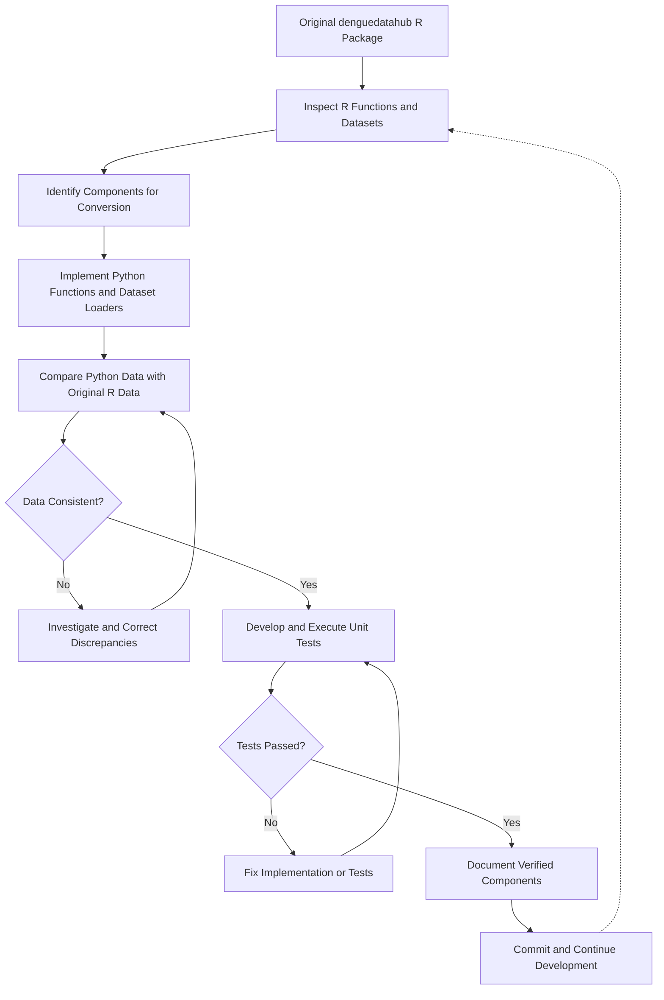

# DengueDataHub – Python Implementation

**A Python implementation of the [denguedatahub R package](https://github.com/thiyangt/denguedatahub).**

**Project Status:** Under Active Development

## Introduction

DengueDataHub is an R package developed to provide the research community with a unified collection of worldwide dengue-related datasets, together with exogenous variables that support the understanding of dengue transmission and the reproducibility of research.

The **denguedatahubpythonicway** project aims to develop a Python implementation of the original R package, making its datasets and relevant functionality accessible within the Python ecosystem.

The project focuses on translating R functions into Python, integrating dengue-related datasets from multiple geographical regions, and developing reusable functions for data loading, preprocessing, and transformation.

An important aspect of this implementation is maintaining consistency between the original R datasets and their Python equivalents through systematic data comparison, validation, and unit testing.

The initial implementation of all 21 identified datasets has been completed. Current development focuses on further validation, documentation, and examining additional components of the original R package.

This project is undertaken as part of **DSA 609 – Seminar Course**, MSc in Data Science and Artificial Intelligence, University of Sri Jayewardenepura, Sri Lanka.

## Objectives

The main objective is to develop a functional, reliable, and reusable Python implementation of the existing denguedatahub R package.

The specific objectives are:

1. **Analyze the existing R package:** Examine R functions, datasets, dependencies, and package structure to identify components for Python implementation.

2. **Convert R functions into Python:** Implement equivalent Python functionality while preserving the intended behavior of the original R functions.

3. **Integrate dengue-related datasets:** Convert and organize existing dengue datasets into Python-compatible formats.

4. **Preserve data integrity:** Validate Python datasets against their original R equivalents, ensuring consistency in data values, structure, and missing-value representation.

5. **Implement data preprocessing:** Develop reusable functions for normalization, cleaning, loading, and transformation.

6. **Ensure reliability through testing:** Develop and execute unit tests using Pytest to verify implemented functionality.

7. **Develop a reusable Python package:** Organize modules, datasets, tests, and documentation into a maintainable Python package.

## Project Workflow

The project follows an incremental development workflow consisting of six main stages.

### Stage 1: Examination of the Original R Package

- Examine the structure of the original denguedatahub repository.
- Inspect R functions and their intended purposes.
- Identify datasets available in the original `data/` and `data-raw/` directories.
- Review relevant R documentation.
- Identify components requiring Python implementation.

### Stage 2: Python Package Development

- Establish the Python package structure.
- Configure dependencies and project metadata.
- Translate selected R functions into Python.
- Implement reusable data-loading and preprocessing modules.

### Stage 3: Dataset Integration

- Identify existing tidy datasets from the original R package.
- Examine original R dataset structures and data types.
- Convert datasets into Python-compatible formats where necessary.
- Implement corresponding Python dataset-loading functions.
- Organize the converted datasets within the Python package.

### Stage 4: Data Validation

- Compare Python datasets against their original R equivalents.
- Verify dataset dimensions and column names.
- Compare data values and data types.
- Check missing values and character encoding.
- Identify and correct inconsistencies introduced during conversion.

### Stage 5: Unit Testing

- Develop corresponding unit tests for Python modules.
- Execute tests using Pytest.
- Verify expected outputs and data-loading functionality.
- Correct identified issues.
- Repeat testing after modifications.

### Stage 6: Documentation and Further Development

- Document implemented Python functions and datasets.
- Maintain documentation describing dataset structure, variables, and original sources.
- Update the README and project structure.
- Inspect additional R functions and data-processing scripts.
- Maintain version control through Git and GitHub.
- Continue developing and validating additional components.

## Workflow Diagram



## Current Implementation Progress

The project has progressed from implementing basic data-processing functions to developing Python modules for all 21 identified dengue-related datasets in the original R package.

### 1. Data Processing and Transformation

The following functions have been implemented:

| Module | Description |
|---|---|
| `min_max.py` | Performs min-max normalization, including grouped normalization. |
| `get_pdflinks_srilanka.py` | Retrieves links to Sri Lankan Weekly Epidemiological Reports. |
| `download_pdfwer_srilanka.py` | Downloads Weekly Epidemiological Report PDF files. |
| `convert_slwer_to_tidy.py` | Extracts and restructures epidemiological report tables into tidy data. |

**Note:** PDF-related modules were developed during the initial conversion stages. Subsequent development prioritizes reusing existing tidy datasets from the original R package where available.

### 2. Dataset Implementation

Python implementations have been developed for all 21 identified datasets.

| Dataset | Implementation |
|---|---|
| `americas_annual_data` | Completed |
| `cdc_casesby_week` | Completed |
| `cdc_dengue_agesex` | Completed |
| `cdc_dengue_casesbyjurisdiction` | Completed |
| `cdc_dengue_countyyear` | Completed |
| `cdc_local_dengue_cases` | Completed |
| `cdc_travel_associated_dengue_cases` | Completed |
| `cdc_usa_dengue_infection` | Completed |
| `china_annual_data` | Completed |
| `india_annual_data` | Completed |
| `korea_dengue` | Completed |
| `level_of_risk` | Completed |
| `philippines_daily_data` | Completed |
| `singapore_weekly_data` | Completed |
| `sl_annual` | Completed |
| `sl_dengue_serotype` | Completed |
| `sl_province_districts` | Completed |
| `sl_sites` | Completed |
| `srilanka_weekly_data` | Completed |
| `taiwan_dengue` | Completed |
| `world_annual` | Completed |

These implementations provide Python-based access to dengue-related datasets from multiple geographical regions and data sources.

Additional functionality and datasets, including the Sri Lanka 2020 dataset and CDC-related utilities, have also been examined and implemented during development.

## Dataset Conversion and Validation

Dataset conversion is an important component of this project. Existing datasets from the original R package are examined, converted where necessary, and integrated into the Python implementation.

Converted datasets are compared with their original R equivalents to verify consistency in structure, values, missing data, and character encoding.

### Dataset Implementation Progress

As of 30 October 2026:

| Description | Progress |
|---|---|
| Identified original dataset items | 21 |
| Completed Python implementations | 21 |
| Implementation completion | 100% |
| R–Python equivalence verified | 13 |
| Remaining equivalence checks | 8 |

The implementation percentage applies only to the 21 identified dataset items and does not indicate completion of the entire R-to-Python package conversion.

### R–Python Equivalence Verification

The following datasets have undergone equivalence verification against their original R versions:

- `china_annual_data`
- `india_annual_data`
- `korea_dengue`
- `level_of_risk`
- `philippines_daily_data`
- `singapore_weekly_data`
- `sl_annual`
- `sl_dengue_serotype`
- `sl_province_districts`
- `sl_sites`
- `srilanka_weekly_data`
- `taiwan_dengue`
- `world_annual`

### Remaining Verification Work

Further R–Python equivalence verification is required for:

- `americas_annual_data`
- `cdc_casesby_week`
- `cdc_dengue_agesex`
- `cdc_dengue_casesbyjurisdiction`
- `cdc_dengue_countyyear`
- `cdc_local_dengue_cases`
- `cdc_travel_associated_dengue_cases`
- `cdc_usa_dengue_infection`

The Americas dataset requires additional examination because a discrepancy has been identified between the documented original R dataset dimensions and the current Python dataset.

### Selected Validation Results

**China Annual Dataset**
- Validated against the original R dataset.
- Corrected numeric parsing involving thousands separators.
- Verified consistency between the R and Python datasets.

**India Annual Dataset**
- Implemented the Python data loader.
- Verified 432 rows and 5 columns.
- Compared the dataset with the original R data, including expected missing values.

**Level of Risk Dataset**
- Implemented the Python data loader.
- Verified 293 rows and 4 columns.
- Confirmed consistency with the original R dataset.
- Corrected character encoding for `São Tomé and Príncipe`.

## Documentation

Documentation is being developed to describe the implemented Python functions and datasets.

The documentation is based on the original R package documentation and the corresponding Python implementations.

### Dataset Documentation

Dataset documentation includes, where applicable:

- Dataset name and description.
- Original data source.
- Dataset dimensions.
- Variable names and descriptions.
- Data types and missing values.
- Corresponding Python data-loading function.
- Validation information.

Documentation for the 21 identified datasets is currently being prepared, with priority given to datasets whose R–Python equivalence has been verified.

### Function Documentation

Documentation has been prepared for the following functions:

- `min_max`
- `get_pdflinks_srilanka`
- `download_pdfwer_srilanka`
- `convert_slwer_to_tidy`

Additional documentation will be developed as the remaining components are reviewed.

## Repository Structure

The repository separates Python modules, datasets, tests, and documentation into dedicated directories.

```text
denguedatahubpythonicway/
│
├── denguedatahub/
│   ├── __init__.py
│   ├── data/
│   ├── cdc.py
│   ├── min_max.py
│   ├── get_pdflinks_srilanka.py
│   ├── download_pdfwer_srilanka.py
│   ├── convert_slwer_to_tidy.py
│   └── load_*.py
│
├── tests/
│   └── test_*.py
│
├── docs/
│   └── Dataset and function documentation
│
├── .gitignore
├── pyproject.toml
└── README.md
```

The structure above is a simplified representation of the repository. The `load_*.py` and `test_*.py` entries represent the individual dataset-loading modules and their associated tests.

## Installation

The Python implementation can be installed locally from the GitHub repository.

### 1. Clone the Repository

```bash
git clone https://github.com/thiyangt/denguedatahubpythonicway.git
```

### 2. Navigate to the Project Directory

```bash
cd denguedatahubpythonicway
```

### 3. Install the Package

Install the package in editable mode:

```bash
python -m pip install -e .
```

This allows changes made to the local Python modules to be reflected without reinstalling the package.

## Testing and Validation

Unit testing is performed using **Pytest**.

Tests have been developed for the implemented data-loading, preprocessing, and transformation functions.

The test suite is executed incrementally as modules are implemented or modified.

Unit testing and R–Python equivalence verification are treated as separate validation activities. Passing unit tests confirms that the tested functionality behaves as expected, while equivalence verification compares converted datasets with their original R versions.

### Running the Tests

Install Pytest if necessary:

```bash
python -m pip install pytest
```

From the repository root directory, execute:

```bash
python -m pytest -v
```

This command executes the test suite and displays the results of individual tests.

## Future Work

Although Python implementations for all 21 identified datasets have been completed, the overall project remains under development.

Current and planned activities include:

- Complete the remaining eight R–Python dataset equivalence checks.
- Complete documentation for all 21 datasets.
- Continue documenting implemented Python functions.
- Inspect additional datasets and data-processing scripts beyond the original 21 identified datasets.
- Examine remaining R utility functions for possible Python conversion.
- Continue improving test coverage and package reliability.
- Verify package exports, installation, and dataset inclusion.
- Refine package organization and usability.

## Original Project and References

This Python implementation is based on the original **denguedatahub R package**.

- **Original R Package:** https://github.com/thiyangt/denguedatahub
- **Original Package Website:** https://thiyangt.github.io/denguedatahubweb/
- **Python Implementation:** https://github.com/thiyangt/denguedatahubpythonicway

## Project Status

**Status: Under Active Development**

As of 30 October 2026, Python implementations for all 21 identified datasets have been completed.

Thirteen datasets have undergone R–Python equivalence verification, while eight require further comparison.

Current work focuses on completing dataset documentation, verifying the remaining datasets, and examining additional components of the original R package.
