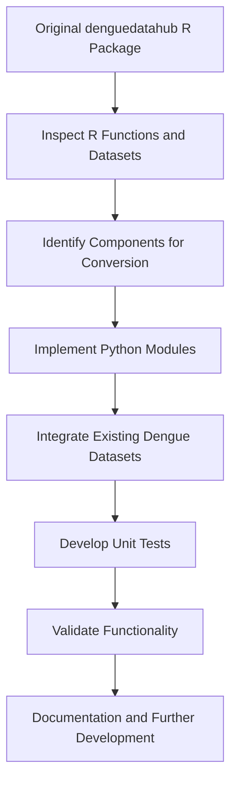

# DengueDataHub – Python Implementation

## Introduction

Dengue is a major public health concern in many tropical and subtropical countries. Access to well-organized dengue-related datasets is essential for epidemiological research, disease surveillance, statistical analysis, and data-driven decision-making.

The **denguedatahubpythonicway** project aims to develop a Python implementation of the existing [denguedatahub R package](https://github.com/thiyangt/denguedatahub).

The project focuses on converting relevant R functions into Python, integrating existing dengue-related datasets, and developing reusable Python functions for data loading, preprocessing, and transformation.

The implementation is carried out incrementally, with unit testing to verify the functionality of the converted components.

This project is undertaken as part of **DSA 609 – Seminar Course**, MSc in Data Science and Artificial Intelligence, University of Sri Jayewardenepura, Sri Lanka.

## Objectives

The main objective of this project is to develop a functional and reusable Python implementation of the existing denguedatahub R package.

The specific objectives are:

1. **Analyze the existing R package:** Examine the original R functions, datasets, dependencies, and package structure to identify the components required for Python implementation.

2. **Convert R functions into Python:** Implement equivalent Python functions while preserving the intended functionality of the original R implementations.

3. **Integrate dengue-related datasets:** Identify, organize, and load existing dengue datasets into Python-compatible data structures for further analysis.

4. **Implement data preprocessing and transformation:** Develop functions for data normalization, cleaning, and restructuring using Python libraries such as Pandas and NumPy.

5. **Ensure functionality through testing:** Develop and execute unit tests using Pytest to verify the correctness and reliability of the implemented Python functions.

6. **Develop a reusable Python package:** Organize the implementation into a modular Python package that can be maintained, extended, and used for dengue-related data analysis.

## Project Workflow

The project follows an incremental development workflow consisting of five main stages.

### Stage 1: Examination of the Original R Package

- Examine the structure of the original denguedatahub repository.
- Inspect R functions and their intended purposes.
- Identify datasets and data-processing scripts.
- Classify components according to their relevance to the Python implementation.

### Stage 2: Python Package Development

- Establish the Python package structure.
- Configure package dependencies and project metadata.
- Translate selected R functions into Python modules.
- Use appropriate Python libraries to reproduce the original functionality.

### Stage 3: Dataset Integration

- Examine the datasets available in the original R package.
- Identify existing tidy datasets that can be reused directly.
- Convert or organize datasets into Python-compatible formats where necessary.
- Implement Python functions to load and process the datasets.

### Stage 4: Testing and Validation

- Develop unit tests for implemented Python functions.
- Execute tests using Pytest.
- Verify expected outputs and handle identified errors.
- Compare functionality with the original R implementation where applicable.

### Stage 5: Documentation and Further Development

- Document the purpose and functionality of implemented modules.
- Update the repository as new components are developed.
- Extend dataset support and implement additional functions.
- Improve package usability, testing, and documentation.

## Workflow Diagram



## Current Implementation Progress

The following Python modules have been implemented during the initial development stages.

| Module | Description |
|---|---|
| `min_max.py` | Implements min-max normalization, including support for grouped data. |
| `get_pdflinks_srilanka.py` | Retrieves links to Sri Lankan Weekly Epidemiological Reports. |
| `download_pdfwer_srilanka.py` | Downloads Weekly Epidemiological Report PDF files. |
| `convert_slwer_to_tidy.py` | Extracts and restructures epidemiological report tables into tidy data. |
| `load_srilanka_2020.py` | Loads the Sri Lankan dengue dataset for 2020. |

### Additional Completed Work

- Established the Python package structure under `denguedatahub/`.
- Configured the project using `pyproject.toml`.
- Developed unit tests under the `tests/` directory.
- Implemented initial dengue dataset integration.
- Used Git and GitHub for version control and incremental development.

**Note:** PDF-related modules were developed during the initial conversion and testing stages. Subsequent development prioritizes reusing existing tidy datasets from the original R package where available, reducing unnecessary PDF extraction and processing.

## Repository Structure

```text
denguedatahubpythonicway/
│
├── denguedatahub/
│   ├── __init__.py
│   ├── min_max.py
│   ├── get_pdflinks_srilanka.py
│   ├── download_pdfwer_srilanka.py
│   ├── convert_slwer_to_tidy.py
│   ├── load_srilanka_2020.py
│   └── data/
│       └── srilanka_2020.csv
│
├── tests/
│   ├── test_min_max.py
│   ├── test_get_pdflinks_srilanka.py
│   ├── test_download_pdfwer_srilanka.py
│   ├── test_convert_slwer_to_tidy.py
│   └── test_load_srilanka_2020.py
│
├── .gitignore
├── pyproject.toml
└── README.md
```

*The structure above highlights the modules developed so far rather than providing an exhaustive inventory of the repository.*

## Testing

Unit testing is performed using **Pytest** to verify the functionality of the implemented Python modules.

To execute the tests, run the following command from the repository root directory:

```bash
python -m pytest -v
```

Tests are developed incrementally as new Python functions are implemented.

## Future Work

The remaining development activities include:

- Continue inspecting the original R functions and datasets.
- Identify additional components requiring Python implementation.
- Extend Python-based dengue dataset loading functionality.
- Validate converted functions against the original implementations.
- Expand unit test coverage.
- Improve package documentation and usage examples.
- Refine the Python package for wider usability.

## Original Project

This Python implementation is based on the original R package:

**Original R Package:**  
https://github.com/thiyangt/denguedatahub

**Python Implementation:**  
https://github.com/thiyangt/denguedatahubpythonicway

## Project Status

**Status: Under Active Development**

The Python implementation is being developed and tested incrementally. Additional modules and datasets will be integrated as the conversion progresses.
